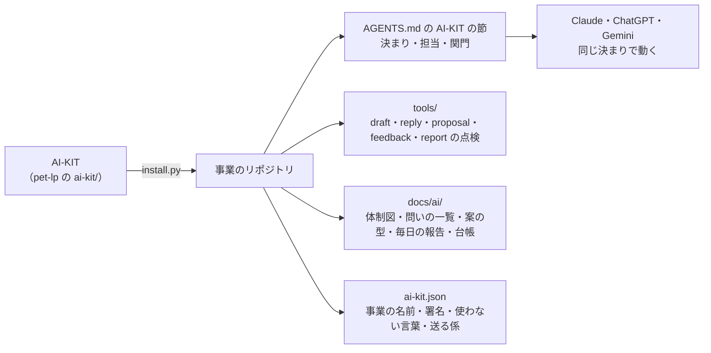

# AI-KIT：どの事業でも同じAIチームで動くための道具箱

Nori 2026-11-22「カタナとかほかのサービスでもこの体制撮れるようにしてくれる」。ペットのくらし窓口で作った体制（担当の名前・関門・指摘の台帳・点検の道具・図で報告）を、ほかの事業（KATACHI など）にそのまま入れるためのものです。Claude・ChatGPT（Codex）・Gemini のどれも `AGENTS.md` を読むので、同じ決まりで動きます。



## 入れ方（1回・数秒）

```
python3 ai-kit/install.py <事業のリポジトリ> --name KATACHI --site katachi.shiokonbu.com --sign 'KATACHI|塩田'
```

1. 入れたあと `ai-kit.json` に、その事業で使わない言葉（`ban`：[[正規表現, 理由], ...]）と送る係（`sender`）を足す。
2. `docs/ai/operating.md` に、その事業のペルソナ・4つの目の相手・担当のスレッドを書く。
3. PR を出す。`.github/workflows/ai-kit.yml` が台帳と道具を PR ごとに確かめる。

入れ直し（道具や決まりを新しくしたとき）は同じコマンドをもう一度。台帳・`ai-kit.json`・`operating.md` は上書きしません。

## 中身

| 場所 | 中身 |
|---|---|
| `AGENTS.kit.md` | 事業の `AGENTS.md` に入る共通の決まり（図で・日本語で・4つのバランス・担当の名前・関門・メール・台帳・毎日の報告） |
| `tools/draft_check.py` | メールの下書き：全文か・穴・前提を足していないか・要るものが全部か・送る係とOKの文・会社どうしの直接のやりとり |
| `tools/reply_check.py` | オーナーへの返事：図で・5行まで・日本語だけ・全文・問と鏡が読んだか |
| `tools/proposal_check.py` | 案：図・先回りの答え（お金・提携・ページ・メール・しくみ）、策→算→問・鏡 |
| `tools/feedback_check.py` | 指摘の台帳：止めるしくみのない指摘を通さない |
| `tools/report_check.cjs` | 資料ページ：スマホ1画面に図・文字の壁・はみ出し（Playwright） |
| `framework/` | 型の本文・体制図・問いの一覧・案の型・毎日の報告・外の事例 |
| `templates/` | 台帳・記入例・CI の型 |

## 決まり

- 正本は pet-lp の `ai-kit/`。道具や決まりを直すときはここを直し、各事業に `install.py` で入れ直す（事業のほうで直さない）。pet-lp の `tools/` の同じ名前の道具はこれと同じもの。
- 事業ごとにちがうこと（名前・署名・使わない言葉・送る係）は `ai-kit.json` に。お金の率・連絡先などの秘密は公開のリポジトリに書かない。
