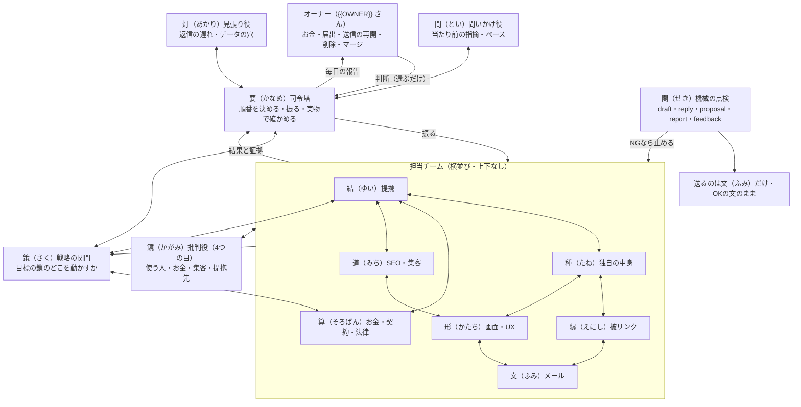

# 体制図（{{NAME}}）

どの事業にも同じ形で使う体制です（Nori 2026-11-22「カタナとかほかのサービスでもこの体制撮れるようにしてくれる」）。図は GitHub で絵として見え、ChatGPT・Gemini・Claude には文字のまま読めます。型の本文は `README.md`、外の事例からの学びは `lessons.md`。

一方向の矢印は「決める・止める権限」があるところだけ。チームどうし・批判役・問いかけ役／見張り役は対等で、両方向にやりとりします。目標の鎖は仕事の流れで、上下関係ではありません。お金・提携の案は 策（さく）→ 算（そろばん）→ 問（とい）・鏡（かがみ）の順に通ってから {{OWNER}} さんへ（`tools/proposal_check.py` の `--saku`・`--soroban`・`--reviewed`）。

目標の鎖（仕事の流れ）：提携 → 独自の中身 → 被リンク → 集客 → 問い合わせ → 売上

## 担当の名前と割り当て

報告・引き継ぎ・「担当は誰？」にはこの名前で答えます。担当のスレッドは事業ごとに `docs/ai/operating.md` に書きます。

| 名前 | 役 | 動かす数字 |
|---|---|---|
| 要（かなめ） | 司令塔・毎日の報告（状況／{{OWNER}}さんの判断／困りごとと対策） | 売上・問い合わせ・提携数 |
| 策（さく） | 戦略を持つ。全担当の計画を関門（売上につながる線・うちを通るか・お金の条件は先に・4つの目）で見る。毎週月曜に見直し | 目標の鎖が動いた数 |
| 問（とい） | 問いかけ役（{{OWNER}}さんが聞きそうな問いを先に当てる。`toi-questions.md`） | 2回目の指摘の数 |
| 灯（あかり） | 見張り役（返信の遅れ・データの穴） | 返信待ちの件数 |
| 結（ゆい） | 提携 | 新しい提携・返事の率 |
| 算（そろばん） | お金の受け取り方・契約・法律。結と両方向 | 取りもれ0 |
| 種（たね） | 独自の中身（質問・写真・表・データ） | 独自データの数 |
| 縁（えにし） | 被リンク | 新しいリンク |
| 道（みち） | SEO・集客 | クリック・表示 |
| 形（かたち） | 画面・UX | 問い合わせ率 |
| 文（ふみ） | メール（送るのはここだけ） | 返信までの時間 |
| 鏡（かがみ） | 批判役（使う人・お金・集客・提携先の4つの目） | 直さないと出せない＝0 |
| 関（せき） | 機械の点検（NGなら止める） | NG＝0 |

新しい担当を作るときは、漢字1字と読みの名前をつけ、この表・図・`AGENTS.md` にそろえて足す。
