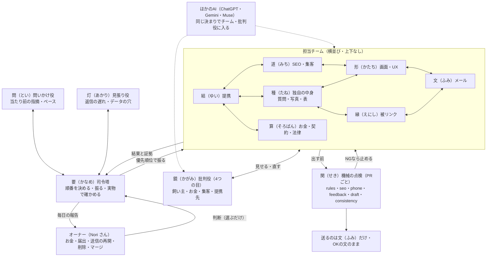

# 体制図（どの事業にも使える型・ペットの記入例つき）

2026-11-22 Nori さん「体制図作って共有して」。図は GitHub で絵として見え、ChatGPT・Gemini・Muse には文字のまま読めます。型の本文は `README.md`、外の事例からの学びは `lessons.md`。

一方向の矢印は「決める・止める権限」があるところだけ。チームどうし・批判役・問いかけ役／見張り役は対等で、両方向にやりとりします（Nori 2026-11-22「並列な役割だと思うところも一方方向への関係になってるようで不安」）。目標の鎖は仕事の流れで、上下関係ではありません。

目標の鎖（仕事の流れ）：提携 → 独自の中身 → 被リンク → 集客 → 問い合わせ → 売上

## 担当の名前と割り当て（ペットのくらし窓口、2026-11-22）

Nori 2026-11-22「これの担当誰？」「担当に名前つけて」。どのAIも、報告・引き継ぎ・相談でこの名前を使います（「結（ゆい）が担当です」）。Nori さんが名前で呼べば、その担当が答えます。

| 名前 | 役 | 担当のスレッド・しくみ | 動かす数字 |
|---|---|---|---|
| 要（かなめ） | 司令塔・毎日の報告 | プロジェクトのコーディネーター | 売上・問い合わせ・提携数 |
| 問（とい） | 問いかけ役（当たり前の指摘・ペース） | 仕組み・体制のスレッド（毎週月曜の見回り、毎朝の報告の前） | 2回目の指摘の数 |
| 灯（あかり） | 見張り役（返信の遅れ・データの穴） | 問い合わせKPIのスレッド（毎朝）と Mac の毎晩の点検 | 返信待ちの件数・いちばん古い時間 |
| 結（ゆい） | 提携 | 提携・売上のスレッド | 新しい提携・返事の率 |
| 算（そろばん） | お金の受け取り方・契約・法律（届出・資金決済法・旅行業法・インボイス）。結と両方向 | お金の受け取り方と契約を整えるスレッド | 届出・契約の進み、取りもれ0 |
| 種（たね） | 独自の中身（質問・写真・表・データ） | 分野ごとのスレッド（火葬の網羅・全分野の網羅・避難・迷子・病院など） | 項目の分かっている割合・独自データの数 |
| 縁（えにし） | 被リンク | 被リンクのスレッド | 新しいリンク |
| 道（みち） | SEO・集客 | SEOのスレッド・無料の集客のスレッド | クリック・表示 |
| 形（かたち） | 画面・UX | フォームのスレッド | 問い合わせ率・離脱の場所 |
| 文（ふみ） | メール（pettaxi.yoyaku から送るのはここだけ） | Mac のメールのスレッド | 返信までの時間 |
| 鏡（かがみ） | 批判役（飼い主・お金・集客・提携先の4つの目） | 仕事ごとに別のエージェント（Claude の別エージェント、または ChatGPT・Gemini・Muse） | 直さないと出せない＝0 |
| 関（せき） | 機械の点検（NGなら止める） | `rules_check`・`seo_check`・`phone_check`・`feedback_check`・`draft_check`・`consistency_check` | NG＝0 |

ほかのAI：ChatGPT＝SNS（道の手伝い）。ほかは `docs/ai/README.md` の手順で、どれかの担当に入る。
新しい担当を作るときは、漢字1字と読みの名前をつけ、この表・図・`AGENTS.md` にそろえて足す。

決めたこと・分かったことは、会話ではなく GitHub（PR・`docs/ai/handoff.md`・指摘の台帳）と pet-db に残したものだけが共有されます。
