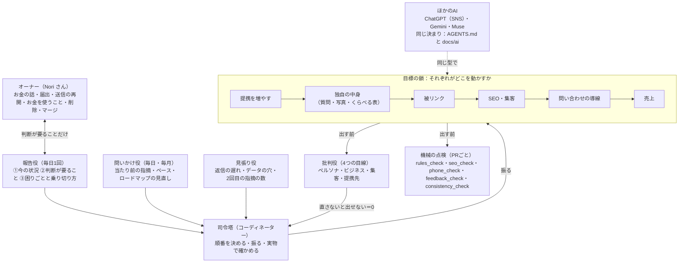

# 体制図（どの事業にも使える型・ペットの記入例つき）

2026-11-22 Nori さん「体制図作って共有して」。図は GitHub で絵として見え、ChatGPT・Gemini・Muse には文字のまま読めます。型の本文は `README.md`、外の事例からの学びは `lessons.md`。

## ペットのくらし窓口での割り当て（2026-11-22）

| 役 | 担当 | 動かす数字 |
|---|---|---|
| 司令塔・報告役 | プロジェクトのコーディネーター | 売上・問い合わせ・提携数 |
| 問いかけ役 | 毎週月曜の見回りと、毎朝の報告の前の点検 | 2回目の指摘の数 |
| 提携を増やす | 提携・売上のスレッド（COCOタク本部・会社のない地域が先） | 新しい提携・返事の率 |
| 独自の中身 | 分野ごとのスレッド（火葬の網羅・全分野の網羅・避難・迷子・病院など） | 項目の分かっている割合・独自データの数 |
| 被リンク | 被リンクのスレッド | 新しいリンク |
| SEO・集客 | SEOのスレッド・無料の集客のスレッド | クリック・表示 |
| 問い合わせの導線 | 問い合わせKPI（毎朝）とフォームのスレッド | 問い合わせ率・離脱の場所 |
| 見張り役（メール） | Mac のメールのスレッド（毎晩） | 返信待ちの件数・いちばん古い時間 |
| 批判役 | 仕事ごとに別のエージェント（Claude の別エージェント、または ChatGPT・Gemini・Muse） | 直さないと出せない＝0 |
| ほかのAI | ChatGPT＝SNS。ほかは `docs/ai/README.md` の手順で | — |

決めたこと・分かったことは、会話ではなく GitHub（PR・`docs/ai/handoff.md`・指摘の台帳）と pet-db に残したものだけが共有されます。
