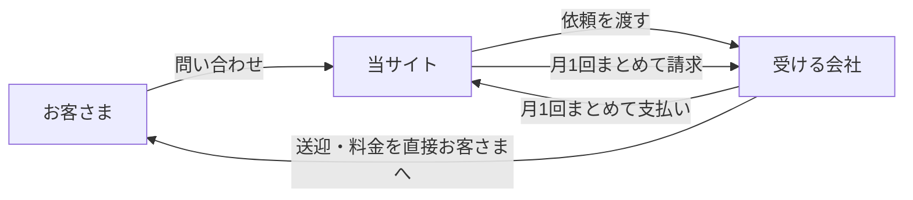

# 案の型（かっこの中を答えに書きかえてから `python3 tools/proposal_check.py <案> --type money --saku 日付 --soroban 日付 --reviewed 日付` を通す。順は 策（さく）→ 算（そろばん）→ 問・鏡。型のままでは通らない）

## 図

## 先回りの答え

- 目的：（目標の鎖のどこを動かすか）
- 4つのバランス：ビジネス…／使う人…／集客…／提携先…
- リスク：（いちばん悪い場合と止め方）
- 例外：（当てはまらない場面とそのとき）
- Noriさんが決めること：（選ぶだけの形とおすすめ。なければ理由）
- お金の流れ：（だれから・だれへ。図のとおり）
- 手数料：（計算のもと。率は公開のリポジトリに書かない）
- 振込手数料：（だれが持つか。月1回まとめるか。安い受け取り方）
- いつ：（締め日・請求日・入金日）
- うちを通す：（会社どうしは直接お金・連絡をしない。受け渡しは当サイトのしくみで）
- 法律：（電気通信事業の届出・資金決済法・旅行業法・景品表示法。届出前はお金の話をしない）
- 相手の気持ち：（相手が損・面倒と感じない言い方）
- 税・インボイス：（請求書・領収書・消費税）
- 返金・取り消し：（取り消し・未払いのとき）
- 当日の追加料金：（待ち時間・道路事情・夜間で増えたとき）
- 事故・トラブル：（だれが受けるか・保険）
- うちの取り分：（どの金額にかけるか・確定の時期・取りもれを防ぐ記録）
