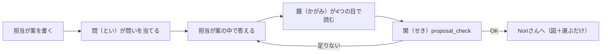

# 問（とい）の先回りの問い（Nori さんが聞く前に答える）

Nori 2026-11-22「振込手数料とかのこと考えてるのか？」「まじでいったことしかできないのか」「考えたらわからない？なぜやらない？」。
提案・計画・大事な下書きは、出す前に問（とい）がこの問いを当て、書いた担当が提案の中の「## 先回りの答え」に答える。
`python3 tools/proposal_check.py <提案> --type <種類>` が足りないものを止める（関（せき））。図がない提案も止める。

## どの案にも（共通）

| 問い | 答えの例 |
|---|---|
| 目的 | 目標の鎖のどこを動かすか（提携・中身・被リンク・集客・問い合わせ・売上） |
| 4つのバランス | ビジネス・使う人・集客・提携先それぞれに1行 |
| リスク | いちばん悪い場合と、その止め方 |
| 例外 | 当てはまらない相手・場面と、そのときどうするか |
| Noriさんが決めること | 選ぶだけの形（おすすめつき）。なければ「なし（理由）」 |

## お金がからむ案（`--type money`）

| 問い | 考えること |
|---|---|
| 全体の流れ | 最初から最後まで先に組んだか（目安の料金 → お客さまが決める → 場所と日時 → 確定料金 → 前金 → 当日）。指摘のたびに1点ずつ直していないか（Nori 11/22「言われたことに反応して答えてるだけ」） |
| 概算と確定 | まず目安、場所と日時のあとに確定料金。お客さまへの見積もりを目安だけで決めていないか |
| お金の流れ | だれから・だれへ・いくら。図で。 |
| 手数料 | 率・計算のもと（確定料金か）・最低額 |
| 振込手数料 | だれが持つか。少ない額をまとめて月1回にするか。振込より安い受け取り方はあるか |
| いつ | 請求・入金・支払いの時期（月末締め・翌月末など） |
| うちを通す | 事業者どうしが直接お金・連絡をしない形か（Nori 11/22「介在価値」） |
| 法律 | 電気通信事業の届出・資金決済法・旅行業法・景品表示法に当たらないか。届出前はお金の話をしない |
| 相手の気持ち | 相手が損・面倒と感じないか。言い方 |
| 税・インボイス | 請求書・領収書・消費税の扱い |
| 返金・取り消し | 取り消し・未払いのときどうするか |
| 当日の追加料金 | 待ち時間・道路事情・夜間で当日に料金が増えたとき、手数料の計算と請求はどうなるか |
| 事故・トラブル | 送迎中の事故・ペットのけが・苦情のとき、だれが受けてどう連絡するか（保険） |
| うちの取り分 | どの金額にかけるか・いつ確定するか・取りもれをどう防ぐか（記録は当サイト） |

## 提携・相手への連絡（`--type partner`）

全体の流れ（最初から最後まで）／相手の得／相手の手間（質問は1回・選ぶだけ）／相手の気持ち／うちを通す／前のやりとり（最新を読んだか・答え済みのことを聞かない）／法律

## ページ・画面（`--type page`）

ペルソナ（だれが・どんな気持ちで）／最初の1画面（答えか探す欄）／集客（どの検索で来るか）／提携先への影響

## メール（`--type mail`）

全文（宛名から署名まで。変えたところだけを見せない）／前提の確かめ（相手が言っていないこと・約束を足していないか。例「難しければ電車で」）／要るものが全部あるか（だれが・なぜ・経路を順に・日付・頼むこと・お支払い・連絡。それ以上は書かない）／前のやりとり／相手の気持ち／先に返事（頼んだ本人に返したか）／送る係（文（ふみ）だけ・OKの文のまま）／法律

## しくみ（`--type system`）

外の事例（lessons.md）／だれが動かす（担当の名前）／止めるしくみ（機械か批判役か）／ほかのAI（同じように使えるか）

問いが足りないと分かったら、この表と `proposal_check.py` の `BY_TYPE` に足す。
